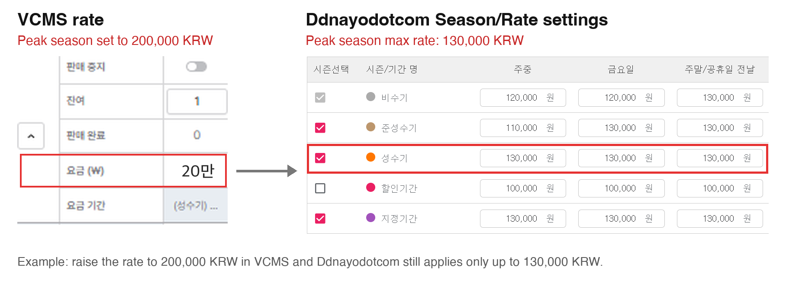

---

## Things to watch with the Ddnayodotcom integration

### An Accommodation PC is required for two-factor authentication

Ddnayodotcom puts the integration through two-factor authentication, so the property needs an Accommodation PC. Without one, the Ddnayodotcom integration is hard to use.

<Warning>
  With no Accommodation PC, two-factor authentication cannot be completed and the Ddnayodotcom integration cannot proceed.
</Warning>

---

### Multi-night bookings arrive split into single nights

Book several nights on Ddnayodotcom and VCMS receives that booking **split night by night** into several bookings. A 3-night booking becomes 3 bookings, a 15-night booking becomes 15.

<Info>
  Ddnayodotcom sometimes bundles separate bookings into one. That can make the night count come out wrong, so VCMS splits Ddnayodotcom bookings into single nights. This way, inventory stays accurate even when part of a booking changes or is canceled.
</Info>

---

### Rates cannot go above the amount in Ddnayodotcom's Season/Rate settings

Ddnayodotcom treats the amount in its Season/Rate settings as the **maximum rate (cap)** for that period, and applies discount rates within it. If you raise a rate in VCMS above that amount, it is not applied on Ddnayodotcom, and the two screens can show different rates.

For example, if peak season is 130,000 KRW in Ddnayodotcom's Season/Rate settings, raising the peak-season rate to 200,000 KRW in VCMS is applied on Ddnayodotcom only up to 130,000 KRW.

<Frame>
  
</Frame>

<Warning>
  If you plan to raise rates for a period, such as peak season, first raise the amount for that period in Ddnayodotcom's Season/Rate settings. Then change the rate in VCMS and it will be applied on Ddnayodotcom.
</Warning>
