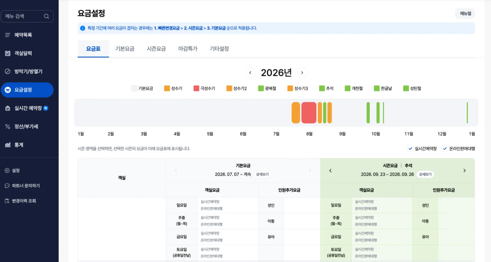

Before connecting the Vendit channel manager (VCMS), check the max inventory set on your Onda Pension Plus packages.

## If rates look different from VCMS

Sign in to Onda Pension Plus and check that your rate settings screen looks like the one below.

<Frame>
  
</Frame>

If your screen matches the image, your property uses the new rate plan. You can't change rates in VCMS for the new rate plan, so change rates directly in Onda Pension Plus.
