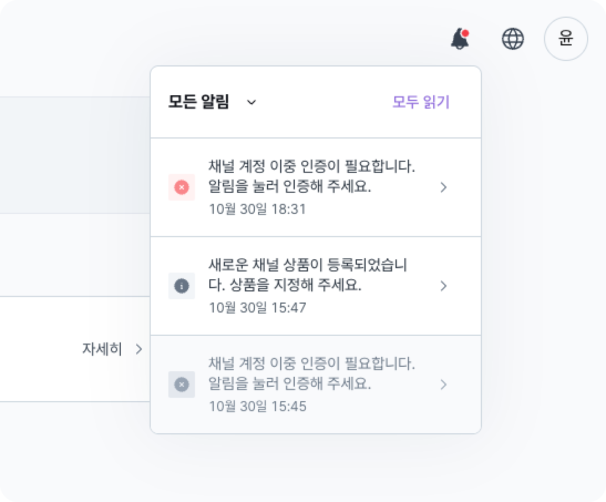
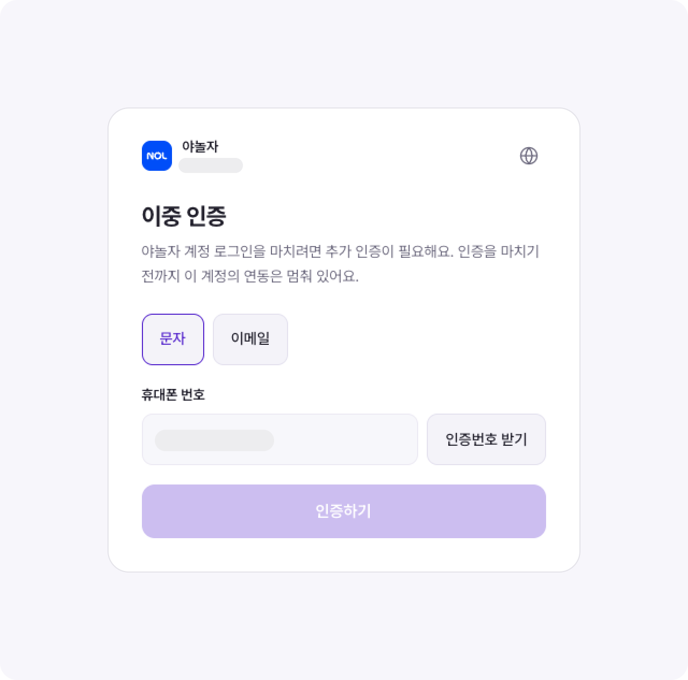
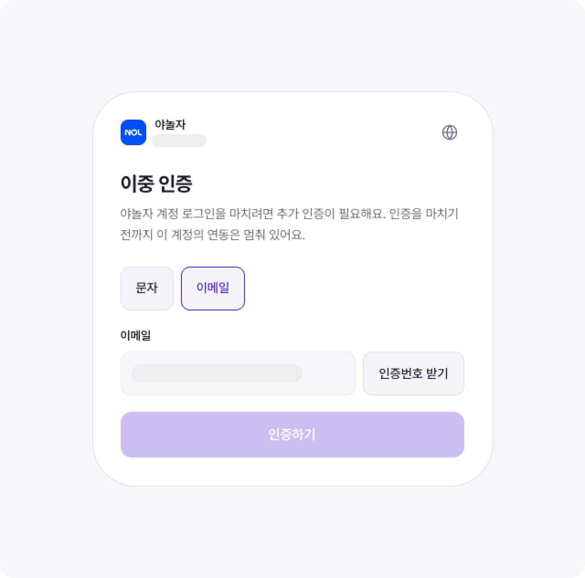

<Info>
  Device authentication on Yanolja is required from November 2, 2026. To connect or reconnect Yanolja, you need to complete device authentication by Phone number or Email. The Yanolja integration stays paused until you finish authentication.
</Info>

**Device authentication steps**

1. **Reconnect Yanolja**: Go to Settings > Channel > Yanolja and click 'Reconnect'.
2. **Check the device authentication notification**: Click the 'Channel account device authentication is required.' message in Notification at the top right of the screen, or the one you got on KakaoTalk.
   <Frame>
     
   </Frame>
3. **Complete device authentication by Phone number or Email**: Get a verification code at the mobile number or email address registered with Yanolja, and enter it to finish. When authentication is done, the Yanolja integration starts again shortly.
   <Columns cols={2}>
     <Column>
       <Frame>
         
       </Frame>
     </Column>
     <Column>
       <Frame>
         
       </Frame>
     </Column>
   </Columns>
