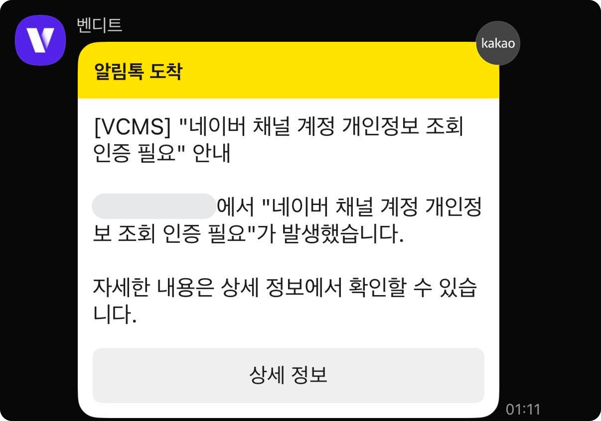
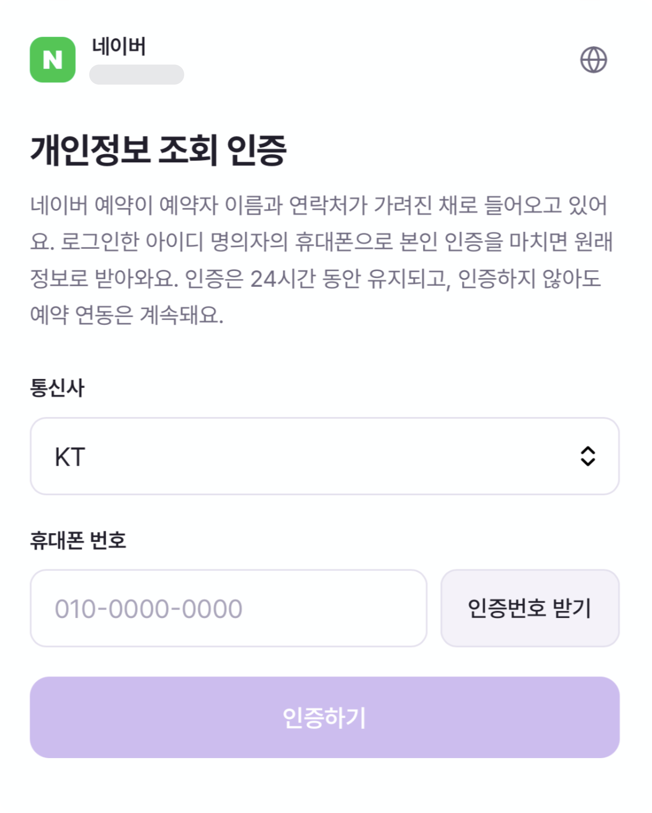

> Starting November 26, 2026, Naver bookings arrive with the guest name, phone number and email masked. To see the original details, the person the Naver ID is registered to must verify with their own mobile phone. You can verify right in VCMS.

<Info>
  Your account is not locked and the connection does not stop if you skip verification. Booking, inventory and rate sync carry on as before. Only the guest name and contact arrive masked.
</Info>

**How to verify**

When verification is needed, a verification link is sent to your property's notification contact.

1. Open the verification link from the notification.
   <Frame>
     
   </Frame>
2. Choose the carrier and enter the mobile number of the person the Naver ID is registered to.
   <Frame>
     
   </Frame>
3. Enter the code you received by text message to finish verifying.

<Info>
  - Once you verify, bookings that arrive afterward show the original details. Bookings that were saved masked are filled in with the original name and contact when they are loaded again.
  - A booking that has been confirmed as normal is not masked again, even if verification lapses.
</Info>

<Warning>
  Under Naver's policy, verification lasts only 24 hours. The period cannot be extended, and after 24 hours a verification request is sent again to the notification contact.
</Warning>

<Note>
  **Shared IDs cannot be verified**

  The phone used to verify must belong to the person the Naver ID is registered to. Naver does not support verification for shared IDs, such as a team ID used by people other than the registered holder. In that case, register the holder's own personal ID as an operator in Naver Smart Place, then reconnect your VCMS channel account with that ID.
</Note>

**Related documents**

- [Naver](/en/channels/naver)
- [Fix Naver connection and account issues](/en/faq/channels/naver-connection)
