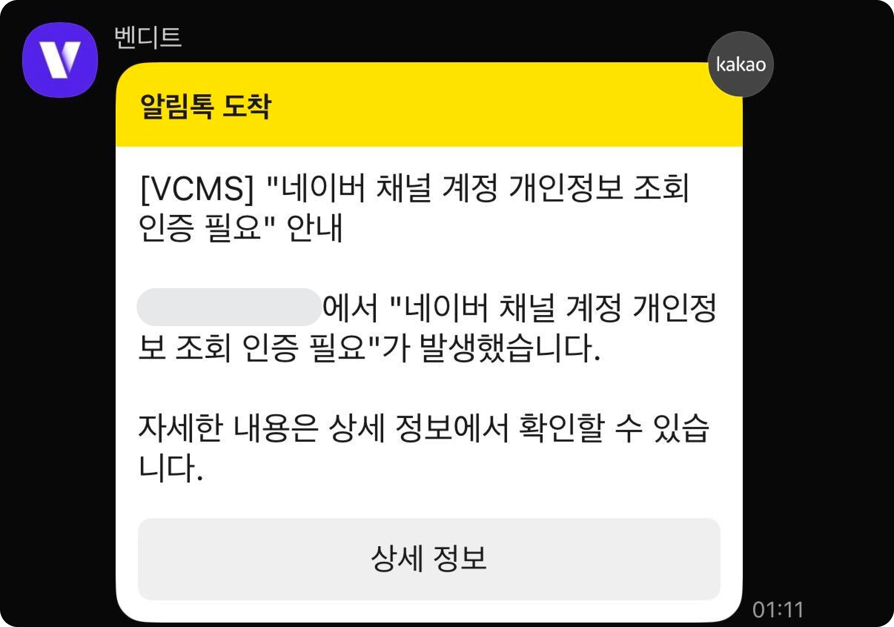
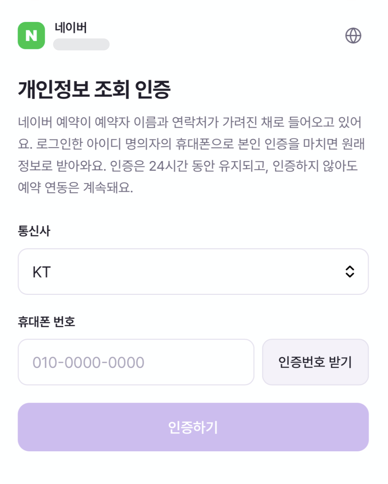

---

> **Highlights** "Verify your identity and see Naver guest details as they are."

## New features

### Verify Naver guest details with identity verification

> For properties that connect Naver

Starting November 26, Naver changed its guest privacy policy. Naver bookings now arrive with the guest name, phone number and email masked. To see the original details, the person the Naver ID is registered to must verify with their own mobile phone.

**We added a way to verify right in VCMS.** When verification is needed, a verification link is sent to your property's notification contact. On the link, choose the carrier, enter the mobile number of the person the Naver ID is registered to, then enter the code sent by text message.

`KakaoTalk notification message`

<Frame>
  
</Frame>

`Verification link`

<Frame>
  
</Frame>

**Learn more**

- Once you verify, bookings that arrive afterward show the original details. Bookings that were saved masked are filled in with the original name and contact when they are loaded again.
- A booking that has been confirmed as normal is not masked again, even if verification lapses.
- The phone used to verify must belong to the person the Naver ID is registered to. A number that belongs to someone else will not verify.
- Naver does not support verification for shared IDs, such as a team ID used by people other than the registered holder. In that case, register the holder's own personal ID as an operator in Naver Smart Place, then reconnect your VCMS channel account with that ID.

<Info>
  **The connection keeps running without verification**

  Your account is not locked and the connection does not stop if you skip verification. Booking, inventory and rate sync carry on as before. Only the guest name and contact arrive masked.
</Info>

<Warning>
  **Verification lasts only 24 hours**

  This follows Naver's policy, so the verification period cannot be extended. After 24 hours, a verification request is sent again to the notification contact.
</Warning>
