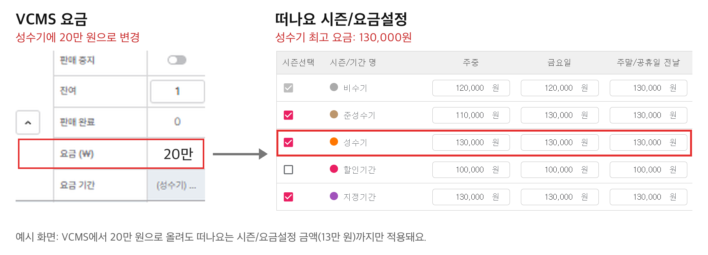

---

## 떠나요 연동 유의사항

### 2차 인증을 위해 숙박업소 PC가 반드시 필요해요

떠나요는 연동 시 2차 인증을 거치기 때문에, 숙박업소 PC가 반드시 구비되어 있어야 해요. 숙박업소 PC가 없으면 떠나요 연동을 사용하기 어려워요.

<Warning>
  숙박업소 PC가 준비되어 있지 않으면 2차 인증을 완료할 수 없어, 떠나요 연동을 진행할 수 없어요.
</Warning>

---

### 연박 예약은 1박씩 나눠서 들어와요

떠나요에서 여러 박을 예약하면, VCMS에는 그 예약이 **1박씩 나뉘어** 여러 건으로 들어와요. 예를 들어 3박 예약은 예약 3건, 15박 예약은 예약 15건으로 생성돼요.

<Info>
  떠나요는 서로 다른 예약을 하나로 묶어서 보내주는 경우가 있어요. 이때 실제 박수가 다르게 계산될 수 있어서, VCMS는 떠나요 예약을 1박 단위로 나눠 관리해요. 이렇게 하면 예약 일부가 바뀌거나 취소돼도 재고가 정확하게 유지돼요.
</Info>

---

### 요금은 떠나요 시즌/요금설정 금액보다 높게 올릴 수 없어요

떠나요는 시즌/요금설정에 적힌 금액을 그 기간의 **최고 요금(상한)** 으로 두고, 그 안에서 할인율을 적용해 판매해요. 그래서 VCMS에서 요금을 그 금액보다 높게 올려도 떠나요에는 반영되지 않고, 두 화면의 요금이 다르게 보일 수 있어요.

예를 들어 떠나요 시즌/요금설정에서 성수기가 13만 원이면, VCMS에서 성수기 요금을 20만 원으로 올려도 떠나요에는 13만 원까지만 적용돼요.

<Frame>
  
</Frame>

<Warning>
  성수기처럼 요금을 올릴 기간이 있다면, 먼저 떠나요 시즌/요금설정에서 그 기간의 금액을 올려 주세요. 그 뒤에 VCMS에서 요금을 바꾸면 떠나요에 반영돼요.
</Warning>