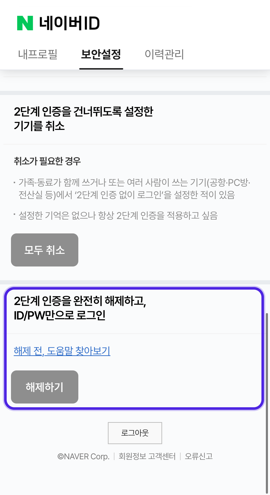
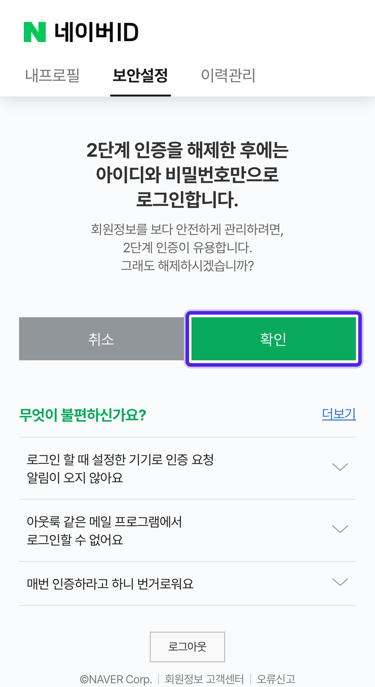
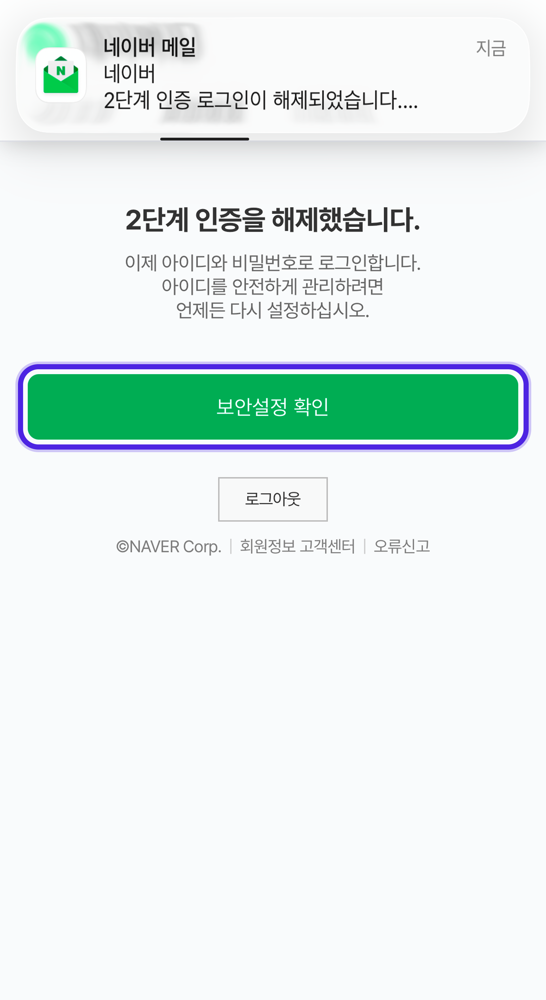
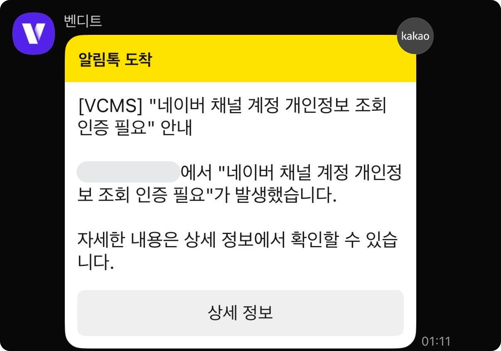
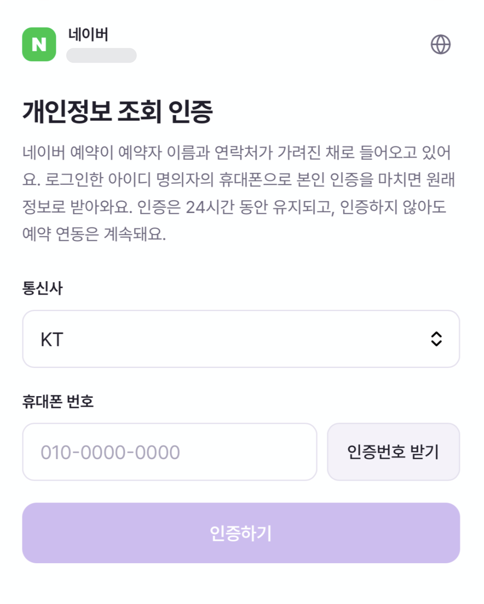

---

## 네이버 연결

네이버를 VCMS에 연결하려면 먼저 **네이버 2단계 인증을 해제**한 뒤, 기존 네이버 아이디·비밀번호로 연결해 주세요.

<Warning>
  네이버 연결이 끊어졌다면 아래 순서대로 다시 연결해 주세요.
</Warning>

### 1단계. 네이버 2단계 인증 해제

<Tabs>
  <Tab title="모바일">
    네이버앱 왼쪽 위 메뉴(≡) > 내 이름 > **2단계 인증 관리** > 비밀번호 재입력 > 페이지 맨 아래 **'해제하기'**

    <Columns cols={3}>
      <Column>
        <Frame>
          
        </Frame>
      </Column>
      <Column>
        <Frame>
          
        </Frame>
      </Column>
      <Column>
        <Frame>
          
        </Frame>
      </Column>
    </Columns>
  </Tab>
  <Tab title="PC">
    네이버ID > 보안설정 > 기본보안설정 > **2단계 인증 관리** > 비밀번호 재입력 > 2단계 인증 설정 취소·해제 > **[2단계 인증을 완전히 해제하고, ID/PW만으로 로그인]** > **'해제하기'**

    <Frame>
      
    </Frame>
  </Tab>
</Tabs>

<Info>
  2단계 인증 해제 방법이 더 궁금하다면 👉 [네이버 2단계 인증 해제 도움말](https://help.naver.com/service/5640/contents/1853?lang=ko&amp;osType=COMMONOS)에서 확인해 주세요.
</Info>

### 2단계. 네이버 로그인 차단 설정 해제

네이버 **보안설정 > 로그인 차단 설정**에서 '타지역 로그인 차단'이 켜져 있으면 VCMS 연결이 되지 않아요. 이 설정도 반드시 해제해 주세요.

<Frame>
  
</Frame>

### 3단계. VCMS에서 네이버 다시 연결

VCMS > 설정 > 채널 > 네이버 > **다시 연결** > 아이디·비밀번호 입력

<Info>
  **참고 사항**

  - 2단계 인증을 해제하면 기존에 만든 애플리케이션 비밀번호는 모두 삭제돼요.
  - 연결 후 2단계 인증을 다시 설정하면 연결이 끊어져요.
</Info>

---

## 네이버 예약자 정보 본인 인증

네이버가 2026년 11월 26일부터 예약자 개인정보 보호 정책을 변경했어요. 이제 네이버 예약의 예약자 이름·전화번호·이메일이 가려진 채로 들어오며, 원래 정보를 보려면 네이버 아이디 명의자의 휴대폰 본인 인증이 필요해요. VCMS에서 바로 인증할 수 있어요.

### 인증 방법

인증이 필요해지면 숙소 알림 연락처로 인증 링크가 발송돼요.

1. 알림으로 받은 인증 링크를 열어 주세요.
   <Frame>
     
   </Frame>
2. 통신사를 고르고 네이버 아이디 명의자의 휴대폰 번호를 입력해 주세요.
   <Frame>
     
   </Frame>
3. 문자로 받은 인증번호를 입력하면 인증이 완료돼요.

<Info>
  - 인증을 마치면 그 뒤로 들어오는 예약은 원래 정보로 표시돼요. 가려진 채 저장돼 있던 예약도 다시 조회될 때 원래 이름과 연락처로 채워져요.
  - 한 번 정상으로 확인된 예약은 인증이 풀리더라도 다시 가려지지 않아요.
</Info>

<Info>
  **인증하지 않아도 연동은 계속돼요**

  인증을 하지 않아도 계정이 잠기거나 연동이 멈추지 않아요. 예약·재고·요금 연동은 그대로 이어지고, 예약자 이름과 연락처만 가려진 채 들어와요.
</Info>

<Warning>
  **인증은 24시간 동안만 유지돼요**

  네이버 정책에 따른 기준이라 인증 유지 시간을 늘릴 수 없어요. 24시간이 지나면 알림 연락처로 인증 요청 알림이 다시 발송돼요.
</Warning>

<Note>
  인증에 쓰는 휴대폰은 반드시 네이버 아이디 명의자 본인의 것이어야 해요. 단체 아이디처럼 명의자가 아닌 분이 함께 쓰는 아이디는 네이버에서 인증을 지원하지 않아요. 이 경우 명의자 본인의 개인 아이디를 네이버 스마트플레이스에 운영자로 등록한 뒤, 그 아이디로 VCMS 채널 계정을 다시 연결해 주세요.
</Note>

---

## 연동 유의사항

<Info>
  네이버 객실 목록에서 오늘의 딜(00:00 미판매시 설정된 할인율 적용), 공휴일 일정을 등록하셨다면 주의해 주세요!

  - 재고/요금 동기화 시 오늘의 딜, 공휴일 일정이 삭제되고 VCMS 판매관리 화면의 재고/요금으로 변경됩니다.
    <Frame>
      
    </Frame>
</Info>

<Warning>
  만약, 재고만 동기화 할 경우, 재고 동기화 과정에서 삭제된 요금 정보로 인해 설정된 공휴일 일정에 상품이 판매되지 않거나, 이전에 등록한 다른 요금으로 판매될 수 있으니 주의해 주세요!
</Warning>
