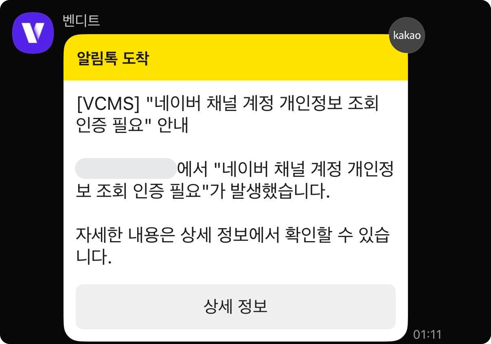
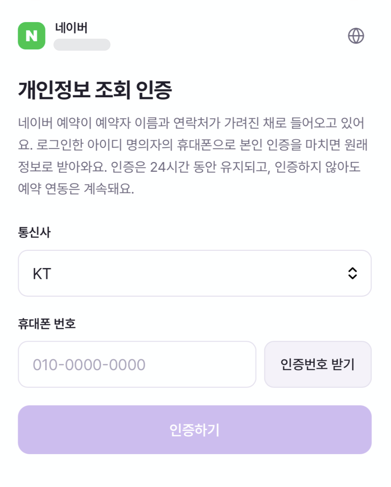

> 2026년 11월 26일부터 네이버 예약의 예약자 이름·전화번호·이메일이 가려진 채로 들어와요. 원래 정보를 보려면 네이버 아이디 명의자의 휴대폰 본인 인증이 필요해요. VCMS에서 바로 인증할 수 있어요.

<Info>
  인증을 하지 않아도 계정이 잠기거나 연동이 멈추지 않아요. 예약·재고·요금 연동은 그대로 이어지고, 예약자 이름과 연락처만 가려진 채 들어와요.
</Info>

**인증 방법**

인증이 필요해지면 숙소 알림 연락처로 인증 링크가 발송돼요.

1. 알림으로 받은 인증 링크를 열어 주세요.
   <Frame>
     
   </Frame>
2. 통신사를 고르고 네이버 아이디 명의자의 휴대폰 번호를 입력해 주세요.
   <Frame>
     
   </Frame>
3. 문자로 받은 인증번호를 입력하면 인증이 완료돼요.

<Info>
  - 인증을 마치면 그 뒤로 들어오는 예약은 원래 정보로 표시돼요. 가려진 채 저장돼 있던 예약도 다시 조회될 때 원래 이름과 연락처로 채워져요.
  - 한 번 정상으로 확인된 예약은 인증이 풀리더라도 다시 가려지지 않아요.
</Info>

<Warning>
  인증은 네이버 정책에 따라 24시간 동안만 유지돼요. 유지 시간은 늘릴 수 없고, 24시간이 지나면 알림 연락처로 인증 요청 알림이 다시 발송돼요.
</Warning>

<Note>
  **단체 아이디는 인증이 안 돼요**

  인증에 쓰는 휴대폰은 반드시 네이버 아이디 명의자 본인의 것이어야 해요. 단체 아이디처럼 명의자가 아닌 분이 함께 쓰는 아이디는 네이버에서 인증을 지원하지 않아요. 이 경우 명의자 본인의 개인 아이디를 네이버 스마트플레이스에 운영자로 등록한 뒤, 그 아이디로 VCMS 채널 계정을 다시 연결해 주세요.
</Note>

**관련 문서**

- [네이버](/ko/channels/naver)
- [네이버 연결과 계정 문제 해결하기](/ko/faq/channels/naver-connection)
